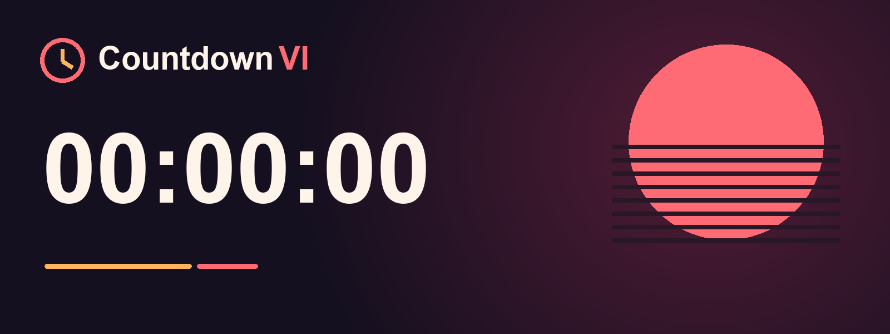

<p align="center">
  
</p>

<p align="center">
  <a href="https://github.com/luandaviap/countdown-vi/actions/workflows/build-ios.yml">
    
  </a>
  
  
  <a href="LICENSE">
    
  </a>
  
</p>

<p align="center">
  <strong>Countdown VI</strong> is an iOS portfolio project featuring a real-time countdown with Lock Screen and Dynamic Island Live Activities.<br>
  Built with SwiftUI, ActivityKit, and WidgetKit, designed to build in CI and run fully offline without a backend server.
</p>

---

## Features

- **Real-Time Countdown:** Continuous countdown display with days, hours, minutes, and seconds, featuring day rollover arithmetic and accessibility support (Dynamic Type and VoiceOver).
- **Live Activity (Dynamic Island & Lock Screen):** Glanceable Lock Screen widget and Dynamic Island presentation (compact and expanded layouts) for compatible devices.
- **Local reminders at fixed milestones:** Scheduled at predefined thresholds (30 days, 7 days, 1 day, 1 hour, and launch moment) defined in `ReleaseConfig.Milestone`.
- **Foreground & Permission Handling:** In-app notification presentation banner when active, with a direct shortcut to iOS Settings if notification permissions are denied.
- **Zero-Server Operation:** Operates independently from backend services; all state, timers, and scheduled notifications reside strictly on-device.

---

## How It Works (Without a Server)

Most countdown applications rely on remote push notifications, background workers, or App Groups to sync widgets with an app. This project deliberately avoids those dependencies to comply with on-device signing constraints (**Decision D-001**):

1. **Native System Timers (`Text(timerInterval:countsDown:)`):**
   The system updates the countdown text automatically, without timer threads or active background app processes.
2. **Local ActivityKit (`pushType: nil`):**
   The Live Activity is requested locally by the application using `Activity.request(attributes:content:pushType: nil)`. It requires no Apple Push Notification service (APNs) keys or remote server tokens.
3. **Local Notifications (`UserNotifications`):**
   Milestone alerts are scheduled directly with the system `UNUserNotificationCenter` using `UNTimeIntervalNotificationTrigger` calculated against the release timestamp.
4. **Single Source of Truth (`ReleaseConfig.swift`):**
   The target date and milestone thresholds reside in a shared configuration file included across all build targets.
5. **Signing Compatibility (Decision D-001):**
   Third-party on-device signers typically do not carry push notification or App Group capabilities. The app deliberately avoids these capabilities to reduce signing friction, though installation and widget extension loading remain subject to physical device testing.

---

## Project Structure

The project is structured into clear domain boundaries and leverages [XcodeGen](https://github.com/yonaskolb/XcodeGen) to keep git history clean and free from `.xcodeproj` merge conflicts:

```
countdown-vi/
├── ios/                       # iOS Application & Extensions
│   ├── project.yml            # XcodeGen project specification
│   ├── CountdownVI/           # Main iOS SwiftUI application
│   ├── CountdownVIWidget/     # WidgetKit & Live Activity extension
│   └── Shared/                # Shared attributes and ReleaseConfig
├── backend/                   # Optional Cloudflare Worker (Phase 2)
├── .github/
│   ├── workflows/             # GitHub Actions CI (macOS-14 builds)
│   ├── ISSUE_TEMPLATE/        # Standardized issue templates
│   └── PULL_REQUEST_TEMPLATE.md
├── assets/                    # Brand assets, palette, app icon, banner
└── docs/                      # Architectural decisions (DECISIONS.md, TASKS.md)
```

---

## CI/CD, Build & Installation

Because local development takes place on Windows without physical macOS hardware, GitHub Actions serves as the primary build environment and compiler.

### Automated CI Pipeline

The [`build-ios.yml`](.github/workflows/build-ios.yml) workflow runs on a `macos-14` (Apple Silicon) runner on every push to `main` and on `workflow_dispatch`:
1. Generates the Xcode project on-the-fly using `xcodegen generate`.
2. Archives the project using `xcodebuild archive` with `CODE_SIGNING_ALLOWED=NO`.
3. Validates that `PlugIns/CountdownVIWidget.appex` is embedded inside `CountdownVI.app`.
4. Packages the unsigned bundle into standard `Payload/` structure and zips `CountdownVI-unsigned.ipa`.
5. Uploads the `.ipa` artifact with a 14-day retention period.

### Installing via On-Device Signing (GBox / ESign / AltStore)

1. Open the [Actions tab](https://github.com/luandaviap/countdown-vi/actions/workflows/build-ios.yml) and select the latest successful run.
2. Scroll to the **Artifacts** section at the bottom and download `CountdownVI-unsigned-build-N.zip`.
3. Unzip the file to obtain `CountdownVI-unsigned.ipa`.
4. Import the `.ipa` into your signing utility on iOS (e.g., GBox, ESign, Feather, or AltStore/Sideloadly on PC as examples).
5. Sign and install with your certificate.

> [!IMPORTANT]
> **On-Device Signing Note:** While the unsigned IPA builds cleanly and embeds `PlugIns/CountdownVIWidget.appex`, how third-party on-device signing tools sign and load widget extensions remains subject to physical iPhone testing.

---

## Limitations & Validation Scope

- **Live Activity Duration (~8h System Limit):**
  Without remote APNs pushes, iOS limits Live Activities to approximately 8 hours of active display before removing them from the Dynamic Island (and up to 4 hours on Lock Screen history). The app automatically requests or re-syncs the activity whenever brought to the foreground (**Decision D-006**).
- **Provisional Launch Date:**
  The current date in `ReleaseConfig` (`2026-11-19T00:00:00-05:00`, `isDateVerified = false`) is an unverified placeholder (**Decision D-004**). The UI clearly labels the countdown as provisional until officially confirmed.
- **Validation Scope:**
  Compiles in GitHub Actions (macOS runner), deployment target iOS 17.0. Hardware-specific behaviors (Dynamic Island layout fitting, notification delivery, widget extension loading) require validation on a physical device.

---

## Screenshots

> **Screenshots coming soon.**  
> Real device screenshots will be added after on-device validation.

---

## Roadmap

- [x] Phase 0: Repository setup, XcodeGen spec, CI workflow generating unsigned IPA.
- [x] Phase 1: MVP App (implemented; compiles in CI: real-time countdown, local Live Activity, local milestone notifications).
- [ ] Phase 1.5: Hardware verification on physical iPhone via GBox/ESign.
- [ ] Phase 2 (Optional): Lightweight Cloudflare Worker in `backend/` to serve verified release dates dynamically without requiring new app builds.

---

## License

This project is licensed under the [MIT License](LICENSE).

---

## Disclaimer

This is an unofficial fan-made project developed strictly for portfolio and educational demonstration. It is not affiliated with, authorized, maintained, sponsored, or endorsed by Rockstar Games, Take-Two Interactive, or any of their affiliates. All trademarks and registered trademarks are the property of their respective owners.
